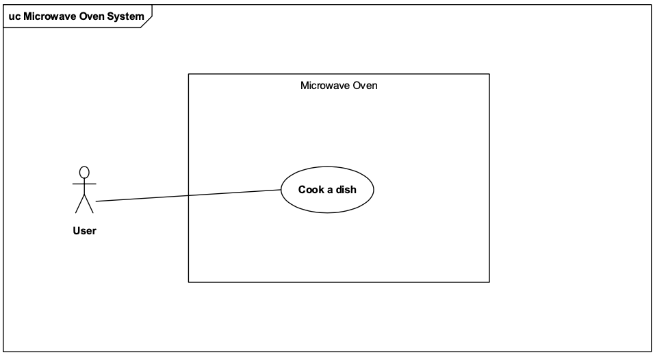
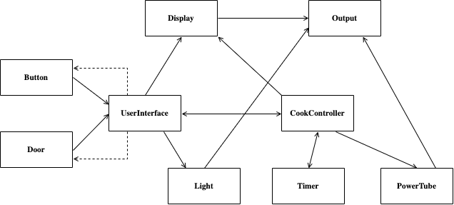
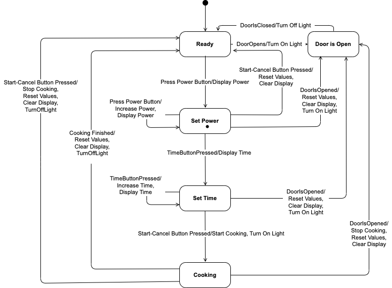
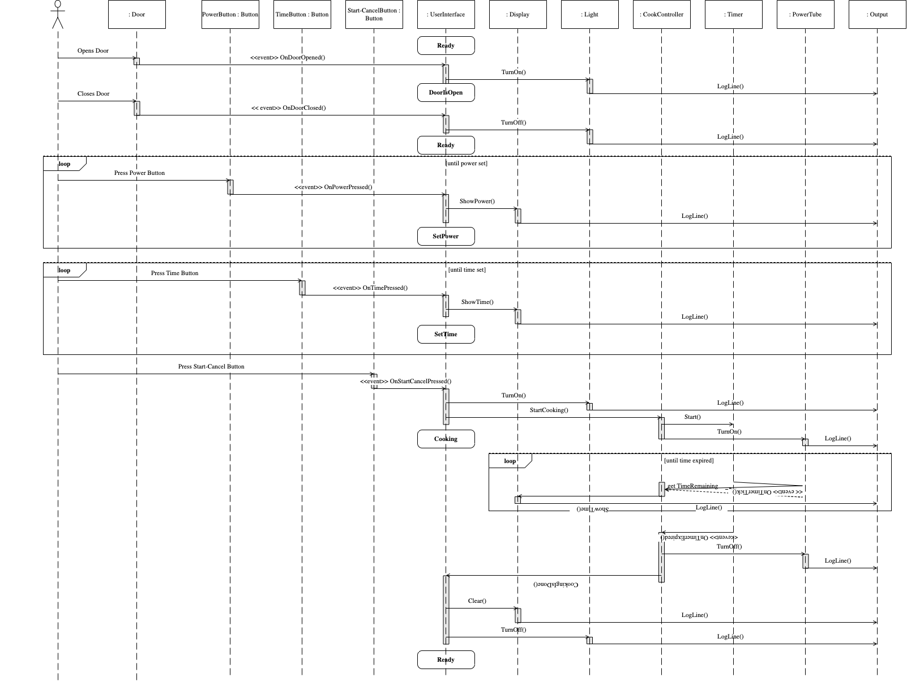
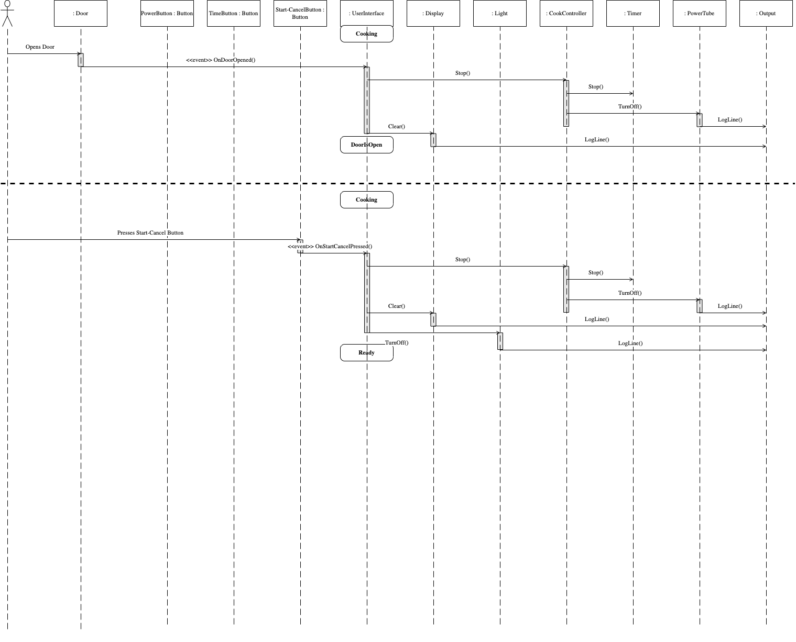

# The Microwave Oven System Description

The following documents the design of the Microwave System.

## Use Case Diagram

## Use Case Description

A beeper has been omitted from this design for the sake of simplicity.

|  **Name**                         |  **Cook a dish**                  |
|-----------------------------------|-----------------------------------|
| **Goal**                          | The user wants to cook a dish of food|
| **Initiation**                    | By the user                    |
| **Actors**                        | The user                        |
| **Precondition**                  | The user has a dish of food on a microwave suitable platter, the MicroWave oven is attached to the mains power supply, no activity is currently taking place in the oven, the display is blank.                       |
| **Postcondition**                 | The oven is inactive, the food has been heated with the desired microwave power during the desired time. The display is blank.                       |
| **Main Scenario**                 | 1. The user opens the door       |
|                                   | 2. The light goes on inside the oven |
|                                   | 3. The user places the dish in the oven |
|                                   | 4. The user closes the door      |
|                                   | 5. The light goes off inside the oven |
|                                   | 6. The user presses the Power button one or more times, to select the desired microwave power. The display shows the currently selected power from 50 to 700 W, starting with 50 W. Each press increases the  selected power level with 50 W, until 700, where it will return to 50 W on the next press. \[Extension 1: The user presses the Start-Cancel button during power setup\] \[Extension 2: The user opens the door during setup\]  |
|                                   | 7. The user presses the Time  button one or more times to  select the desired cooking   time. The display shows the  currently selected time as   minutes:seconds, starting with 01:00. Each press increases the  selected time with one minute. \[Extension 2: The user opens the door during setup] |
|                                   | 8.The user presses the Start-Cancel button. |                                                      |
|                                   | 9.The light goes on inside the oven |
|                                   | 10.The powertube starts working at the desired powerlevel |
|                                   | 11.The display shows and updates the remaing time every second as minutes:seconds.   \[Extension 3: The user presses the Start-Cancel button during cooking\] \[Extension 4: The user opens the Door during cooking\] |
|                                   | 12.When the time has expired, power tube is turned off
||13.The light inside the oven    goes off                       |
|                                   | 14.The display is blanked      |
|                                   | 15.The user opens the door     |
|                                   | 16.The light goes on inside the oven                           |
|                                   | 17.The user removes the food   |
|                                   | 18.The user closes the door    |
|                                   | 19.The light inside the oven    goes off.                       |
| **Extension**                     | \[Extension 1: The user presses the Start-Cancel button during  setup\] 1. The display is blanked   2. All settings are reset to start values 3. The user can start the Use Case from step 6 or 15, or the Use Case ends. |
|                                   | \[Extension 2: The user opens the Door during setup\] 1. The light goes on inside the oven 2. The display is blanked 3. All settings are reset to start values 4. The user can continue the Use case from step 4 or 17. |
|                                   | \[Extension 3: The user presses the Start-Cancel button during  cooking\] 1. The power tube is turned off 2. The display is blanked. 3. The light inside the oven goes off 4. All settings are reset to start values 5. The user can continue the Use Case from step 6 or 15, or the Use Case ends.|
|                                   | \[Extension 4: The user opens the Door during cooking\] 1. The power tube is turned off. 2.The display is blanked. 3.All settings are reset to start values. 4.The user can continue the Use Case from step 4 or 17.|

## Class Diagram

All classes are implementing a relevant interface – not shown on the diagram for simplicity – so dependency isolation
is possible for testing. See the supplied unit tests.

## State Machine diagram for UserInterface

## Sequence diagram for the main scenario and some of the extensions

## Sequence diagrams for the some of the Extensions

