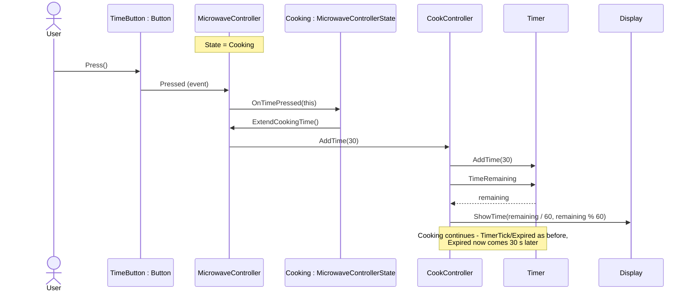

# Feature: Extend cooking time while cooking

## Specification

While the oven is cooking, each press on the **Time** button adds **30 seconds** to the remaining cooking time.
The display immediately shows the new remaining time (minutes:seconds), and the power tube keeps running until
the extended time has expired. Pressing the Time button in any other state behaves as before.

## What has been changed / added

| Class / interface | Change |
|---|---|
| `ITimeProvider` / `Timer` | New method `AddTime(int seconds)`. Adds `seconds` to `TimeRemaining`. Throws `ArgumentOutOfRangeException` if `seconds <= 0`. |
| `ICookController` / `CookController` | New method `AddTime(int seconds)`. If cooking: calls `ITimeProvider.AddTime` and shows the new remaining time on the display. Ignored if not cooking. |
| `IMicrowaveStateContext` / `MicrowaveController` | New method `ExtendCookingTime()`, which calls `ICookController.AddTime(CookingTimeExtensionSeconds)`. New constant `CookingTimeExtensionSeconds = 30`. |
| `Cooking` (state) | Overrides `OnTimePressed`, which calls `context.ExtendCookingTime()`. No state transition. |
| `Program` (ConsoleApp) | Help text updated: `T` while cooking adds 30 seconds. |

STM change for `MicrowaveController`: new internal transition in state **Cooking**:
`TimePressed / ExtendCookingTime()` (stays in Cooking).

## Decisions

* The time can only be **extended**, not shortened. Therefore the remaining time can never reach 0 because of this
  feature, and no extra "stop immediately" handling is needed.
* 30 seconds per press: fine-grained enough to add "a little more", while several presses quickly add minutes.
  The value is a single constant in `MicrowaveController`.
* `CookController.AddTime` ignores calls when not cooking (same guard as `OnTimerTick`), so a press racing with the
  timer expiring cannot restart anything.
* `Timer.AddTime` rejects non-positive values, so the timer cannot be put in an invalid state.

## Sequence diagram

## Tests

* `TimerTest` (unit, BoundaryTest): BVA on `AddTime` – 1, 30, 3600 (valid), 0, -1, -60 (exception), time unchanged on
  invalid input, two calls add up.
* `TimerTest` (integration): `Start(1)` + `AddTime(1)` → `Expired` does not come after 1 s but comes after 2 s.
* `CookControllerTest`: timer called while cooking; display shows correct min:sec (BVA around 60 s: 30, 59, 60, 90);
  ignored before start, after `Stop()` and after the timer has expired (ZOMBIE: zero/one/many states).
* `MicrowaveControllerTest`: Time press while cooking calls `AddTime(30)` once per press (1, 2, 5 presses);
  not called in SetTime or after cooking is done.
* `MicrowaveControllerStateTest`: `OnTimePressed` calls `ExtendCookingTime()` only in `Cooking`.
