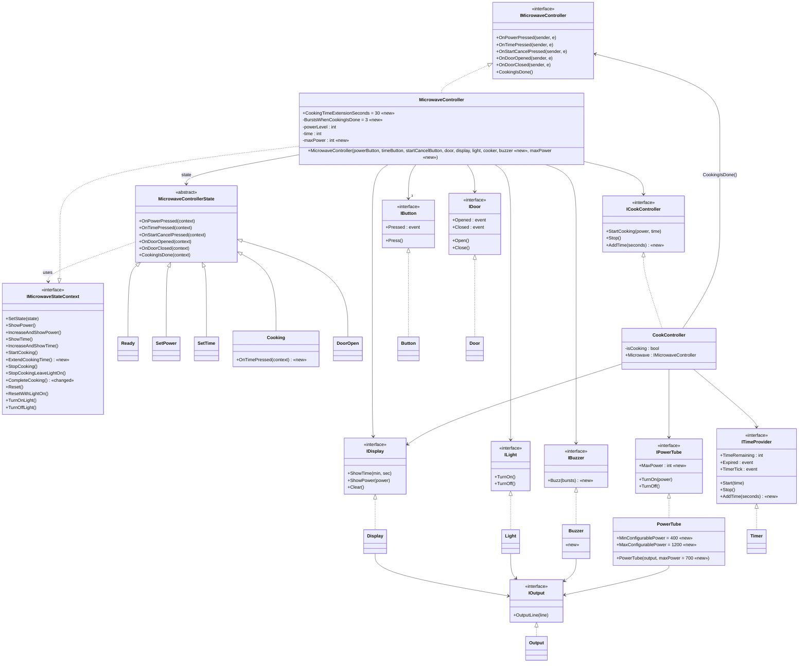
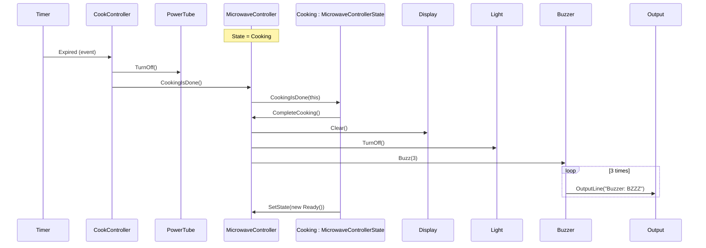
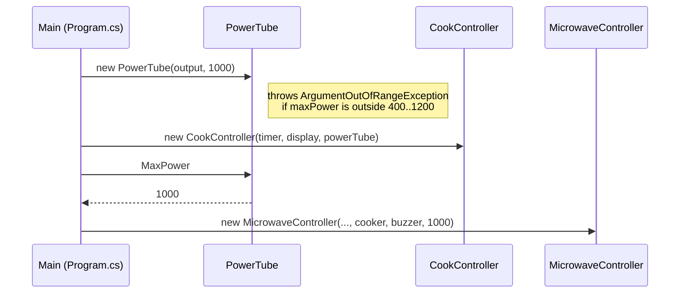
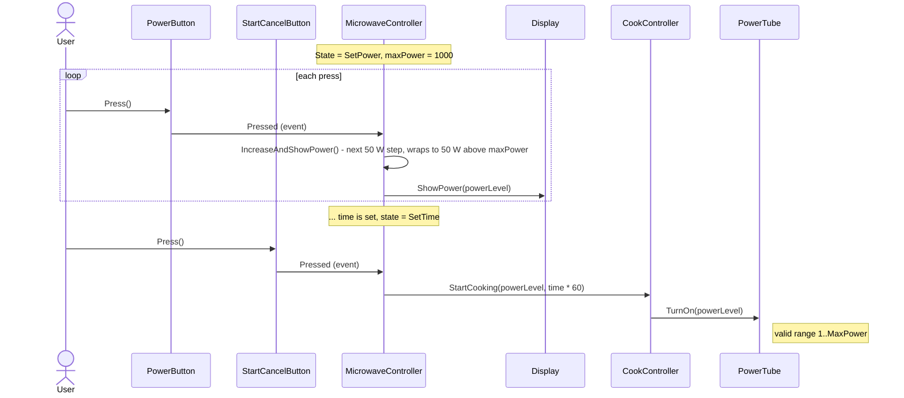
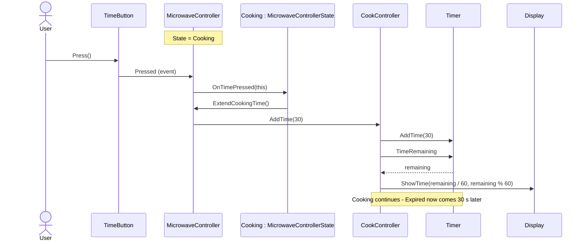
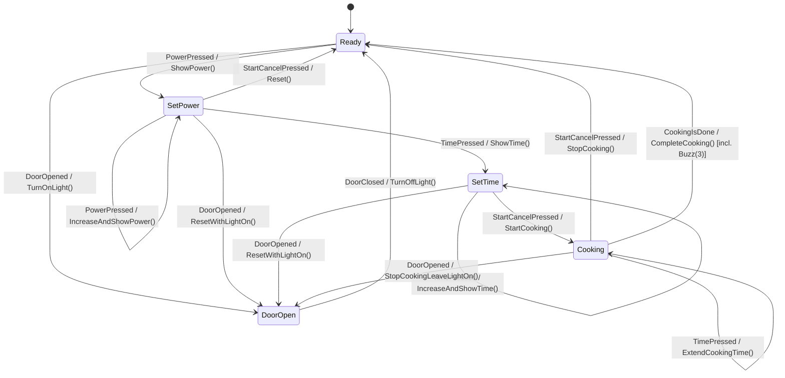
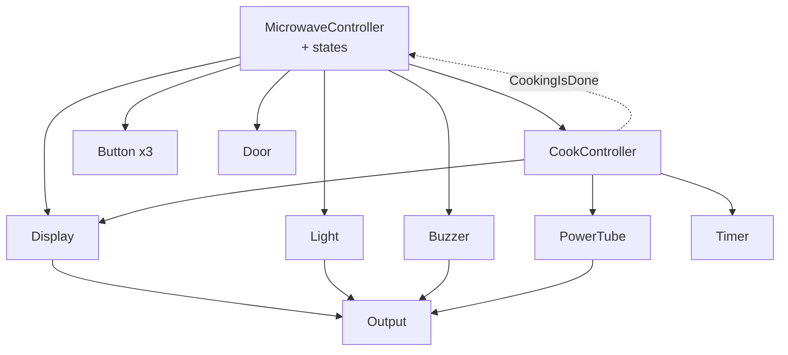

# Microwave Oven – Hand-in 3 documentation (group swt10)

This document describes the final design of the Microwave Oven after the three mandatory features were added:

| # | Feature | Branch |
|---|---|---|
| 1 | Buzzer – 3 short bursts when cooking is done | `feature/buzzer` |
| 2 | Configurable power tube power (400–1200 W) | `feature/configurable-power` |
| 3 | Extend cooking time while cooking | `feature/extend-cooking-time` |

No personal (optional) features have been added.

## 1. Class diagram

Final testable design. New elements are marked with `«new»` / `«changed»`.
All classes depend on the interfaces of the other classes, not on the concrete classes, so every class can be unit
tested with fakes (NSubstitute).

## 2. Sequence diagrams for the new features

### 2.1 Buzzer

The timer expires while cooking. The buzzer is only used here – not on cancel or when the door is opened.

### 2.2 Configurable power tube power

**Start-up in `Main`** – the power is configured in one place only. `MicrowaveController` gets the maximum from the
power tube, so the two can never disagree.

**Selecting and using the power** – the power button cycles in 50 W steps up to the configured maximum and then
wraps around to 50 W. When cooking starts, the power tube checks the power against its own `MaxPower`.

### 2.3 Extend cooking time while cooking

Each press on the Time button while cooking adds 30 seconds to the remaining time.

## 3. State machine diagram for MicrowaveController

Final STM. Changes compared to the original STM:

* **New** internal transition in *Cooking*: `TimePressed / ExtendCookingTime()` (feature 3).
* **Changed** action on *Cooking → Ready* when the cooking is done: `CompleteCooking()` now also buzzes 3 times (feature 1).
* `IncreaseAndShowPower()` in *SetPower* now wraps around at the configured `maxPower` instead of 700 W (feature 2).

Events not shown in a state are ignored in that state (default implementation in `MicrowaveControllerState`).

### 3.1 Other STM diagrams

No new STMs. `CookController` still only has the flag `isCooking` (cooking / not cooking), which is unchanged
except that `AddTime` is ignored when not cooking.

## 4. What has been changed and added

### 4.1 Buzzer

| Class / interface | Change |
|---|---|
| `IBuzzer` | **Added.** `Buzz(int bursts)`. |
| `Buzzer` | **Added.** Boundary class like `Light`. Writes `"Buzzer: BZZZ"` to `IOutput` once per burst. Throws `ArgumentOutOfRangeException` if `bursts < 1`. |
| `MicrowaveController` | **Changed.** Takes an `IBuzzer` in the constructor. `CompleteCooking()` calls `Buzz(3)` (constant `BurstsWhenCookingIsDone`). |
| `Program` | **Changed.** Creates a `Buzzer` and passes it to `MicrowaveController`. |
| Tests | **Added** `BuzzerTest`. **Changed** `MicrowaveControllerTest` (constructor + buzzer tests). |

### 4.2 Configurable power tube power

| Class / interface | Change |
|---|---|
| `IPowerTube` | **Changed.** New property `MaxPower`. |
| `PowerTube` | **Changed.** Constructor takes `maxPower` (default 700), validated to 400–1200 W. `TurnOn` validates the power against `MaxPower` instead of 700. |
| `MicrowaveController` | **Changed.** Constructor takes `maxPower` (default 700). `IncreaseAndShowPower()` wraps at `maxPower`. |
| `Program` | **Changed.** `new PowerTube(output, 1000)` and `powerTube.MaxPower` is passed to `MicrowaveController`. |
| Tests | **Changed** `PowerTubeTest` (BVA on constructor and `TurnOn` with configured max). **Added** `MicrowaveControllerMaxPowerTests`. |

### 4.3 Extend cooking time while cooking

| Class / interface | Change |
|---|---|
| `ITimeProvider` / `Timer` | **Changed.** New method `AddTime(int seconds)`. Throws `ArgumentOutOfRangeException` if `seconds <= 0`. |
| `ICookController` / `CookController` | **Changed.** New method `AddTime(int seconds)`: adds the time to the timer and shows the new remaining time. Ignored when not cooking. |
| `IMicrowaveStateContext` / `MicrowaveController` | **Changed.** New method `ExtendCookingTime()` and constant `CookingTimeExtensionSeconds = 30`. |
| `Cooking` (state) | **Changed.** Overrides `OnTimePressed` → `ExtendCookingTime()`. |
| `Program` | **Changed.** Help text: `T` while cooking adds 30 seconds. |
| Tests | **Added** `TimerTest` (unit) and a timer integration test. **Changed** `CookControllerTest`, `MicrowaveControllerTest`, `MicrowaveControllerStateTests`. |

## 5. Decisions for the individual features

### 5.1 Buzzer

* The buzzer is a boundary class that writes to `IOutput`, like `Light` and `Display`. `Console.Beep()` is not used,
  because it only works on Windows and would fail in the GitLab pipeline (Linux), and the output can be tested.
* The number of bursts is a parameter, so the same buzzer can be used for other signals later. The controller uses
  the constant `BurstsWhenCookingIsDone = 3`.
* The buzzer is only used when the cooking time runs out – not when cooking is cancelled or the door is opened, since
  the user is already at the oven in those cases.

### 5.2 Configurable power tube power

* The power is only configured in `Main`: `new PowerTube(output, 1000)`. `MicrowaveController` gets the value via
  `powerTube.MaxPower`, so there is one single place to change it.
* `MicrowaveController` takes the max power as an `int` and not the `IPowerTube`, so it does not get a new dependency
  on the power tube (it only talks to it through `CookController`).
* `PowerTube` validates the range 400–1200 W in the constructor, so an invalid configuration fails at start-up and
  not while cooking.
* Default value 700 W in both constructors keeps the original behaviour if no value is given.
* The power steps are still 50 W. If the maximum is not a multiple of 50, the highest selectable power is the highest
  multiple of 50 below the maximum.

### 5.3 Extend cooking time while cooking

* Each press adds 30 seconds (constant `CookingTimeExtensionSeconds` in `MicrowaveController`).
* The time can only be extended, not shortened. The remaining time can therefore never reach 0 because of this
  feature, so no extra "stop immediately" handling is needed.
* `CookController.AddTime` is ignored when not cooking (same guard as the timer events), so a press at the same time
  as the timer expires cannot restart anything.
* `Timer.AddTime` rejects values `<= 0`, so the timer cannot be put in an invalid state.

## 6. Personal features

None.

## 7. Integration test

### 7.1 Dependency tree

An arrow `A --> B` means "A depends on B" (A calls B through B's interface).
The dashed arrow is the call-back from `CookController` to `MicrowaveController` (`CookingIsDone()`), which
makes the only cycle in the design. The states (`Ready`, `SetPower`, `SetTime`, `Cooking`, `DoorOpen`) are part of
the `MicrowaveController` module, since they only talk to it through `IMicrowaveStateContext`.

Levels (bottom-up, ignoring the call-back):

| Level | Modules |
|---|---|
| 0 | Output, Timer, Button, Door |
| 1 | Display, Light, PowerTube, Buzzer |
| 2 | CookController |
| 3 | MicrowaveController (+ states) |

### 7.2 Integration plan

Legend: **T** = module under test, **X** = real module included, **S** = stub/fake, **D** = driver (the NUnit test).

| Step | Output | Display | Light | PowerTube | Buzzer | Timer | Button | Door | CookController | MicrowaveController |
|---|---|---|---|---|---|---|---|---|---|---|
| 1 | X | T | T | T | T | | | | D | |
| 2 | X | X | | X | | X | | | T | S |
| 3 | X | X | X | X | X | S | X (D) | X (D) | X | T |

**Step 1 – output boundaries.** Display, Light, PowerTube and Buzzer are integrated with the real `Output`. The test
calls them directly and redirects `Console` (`Console.SetOut(StringWriter)`) to check the exact text written.

**Step 2 – CookController.** `CookController` is integrated with the real `Timer`, `Display`, `PowerTube` and `Output`.
`IMicrowaveController` is a stub (NSubstitute), which breaks the cycle and lets us check that `CookingIsDone()` is
called when the timer expires. Short cooking times (1–3 s) are used, so the real timer can be used without slow tests.
This step also covers `AddTime` (extend cooking time) together with the real timer and display.

**Step 3 – MicrowaveController.** The whole system except the timer is real. The test acts as the user by calling
`Press()` on the real buttons and `Open()`/`Close()` on the real door, and checks the console output (light, display,
power tube, buzzer). `ITimeProvider` is a fake whose `TimerTick`/`Expired` events are raised by the test, because the
shortest cooking time the user can choose is 1 minute. The Timer ↔ CookController integration was already verified in
step 2.

### 7.3 Strategy and decisions

We use a **bottom-up** strategy:

* The bottom of the tree (Output and the boundary classes) is small, already unit tested and easy to observe through the
  console, so each step has a reliable base to build on.
* Bottom-up needs very few stubs: only `IMicrowaveController` in step 2 (to break the only cycle) and the fake timer in
  step 3. Top-down would need stubs for almost every module in the first steps.
* The drivers are simply the NUnit tests, so no extra driver code is needed. In step 3 the real `Button` and `Door`
  objects are used as the drivers, so the system is tested through the same entry points as the real user.
* `Output` is kept real in all steps and observed by redirecting `Console`. This makes the output text itself part of
  the integration test, so formatting errors are caught.
* The real `Timer` is only included in step 2. Using it in step 3 would make every test take at least a minute
  (minimum cooking time is 1 min), and it would not test anything new.
