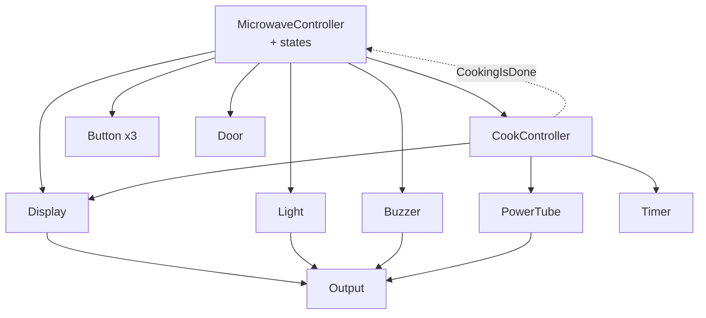

# Microwave Oven – Hand-in 3 documentation (group swt10)

## 1. Class diagram

TODO – updated class diagram with all three features (Buzzer, configurable power, extend cooking time).

## 2. Sequence diagrams for the new features

### 2.1 Buzzer

TODO

### 2.2 Configurable power tube power

TODO

### 2.3 Extend cooking time while cooking

See [feature-extend-cooking-time.md](../Microwave.Docs/feature-extend-cooking-time.md).

## 3. State machine diagram for MicrowaveController

TODO – updated STM. New for *extend cooking time*: internal transition in **Cooking**:
`TimePressed / ExtendCookingTime()`.

## 4. Changes and decisions per feature

TODO – short description of **what** has been changed/added and the decisions for each feature.

## 5. Integration test

### 5.1 Dependency tree

An arrow `A --> B` means "A depends on B" (A calls B through B's interface).
The dashed arrow is the call-back from `CookController` to `MicrowaveController` (`CookingIsDone()`), which
makes the only cycle in the design. The states (`Ready`, `SetPower`, `SetTime`, `Cooking`, `DoorOpen`) are part of
the `MicrowaveController` module, since they only talk to it through `IMicrowaveStateContext`.

Levels (bottom-up, ignoring the call-back):

| Level | Modules |
|---|---|
| 0 | Output, Timer, Button, Door |
| 1 | Display, Light, PowerTube, Buzzer |
| 2 | CookController |
| 3 | MicrowaveController (+ states) |

> Note: the Buzzer is assumed to write to `IOutput` like the other output boundary classes. Update the tree if
> the final Buzzer implementation differs.

### 5.2 Integration plan

Legend: **T** = module under test, **X** = real module included, **S** = stub/fake, **D** = driver (the NUnit test).

| Step | Output | Display | Light | PowerTube | Buzzer | Timer | Button | Door | CookController | MicrowaveController |
|---|---|---|---|---|---|---|---|---|---|---|
| 1 | X | T | T | T | T | | | | D | |
| 2 | X | X | | X | | X | | | T | S |
| 3 | X | X | X | X | X | S | X (D) | X (D) | X | T |

**Step 1 – output boundaries.** Display, Light, PowerTube and Buzzer are integrated with the real `Output`. The test
calls them directly and redirects `Console` (`Console.SetOut(StringWriter)`) to check the exact text written.

**Step 2 – CookController.** `CookController` is integrated with the real `Timer`, `Display`, `PowerTube` and `Output`.
`IMicrowaveController` is a stub (NSubstitute), which breaks the cycle and lets us check that `CookingIsDone()` is
called when the timer expires. Short cooking times (1–3 s) are used, so the real timer can be used without slow tests.
This step also covers `AddTime` (extend cooking time) together with the real timer and display.

**Step 3 – MicrowaveController.** The whole system except the timer is real. The test acts as the user by calling
`Press()` on the real buttons and `Open()`/`Close()` on the real door, and checks the console output (light, display,
power tube, buzzer). `ITimeProvider` is a fake whose `TimerTick`/`Expired` events are raised by the test, because the
shortest cooking time the user can choose is 1 minute. The Timer ↔ CookController integration was already verified in
step 2.

### 5.3 Strategy and decisions

We use a **bottom-up** strategy:

* The bottom of the tree (Output and the boundary classes) is small, already unit tested and easy to observe through the
  console, so each step has a reliable base to build on.
* Bottom-up needs very few stubs: only `IMicrowaveController` in step 2 (to break the only cycle) and the fake timer in
  step 3. Top-down would need stubs for almost every module in the first steps.
* The drivers are simply the NUnit tests, so no extra driver code is needed. In step 3 the real `Button` and `Door`
  objects are used as the drivers, so the system is tested through the same entry points as the real user.
* `Output` is kept real in all steps and observed by redirecting `Console`. This makes the output text itself part of
  the integration test, so formatting errors are caught.
* The real `Timer` is only included in step 2. Using it in step 3 would make every test take at least a minute
  (minimum cooking time is 1 min), and it would not test anything new.
